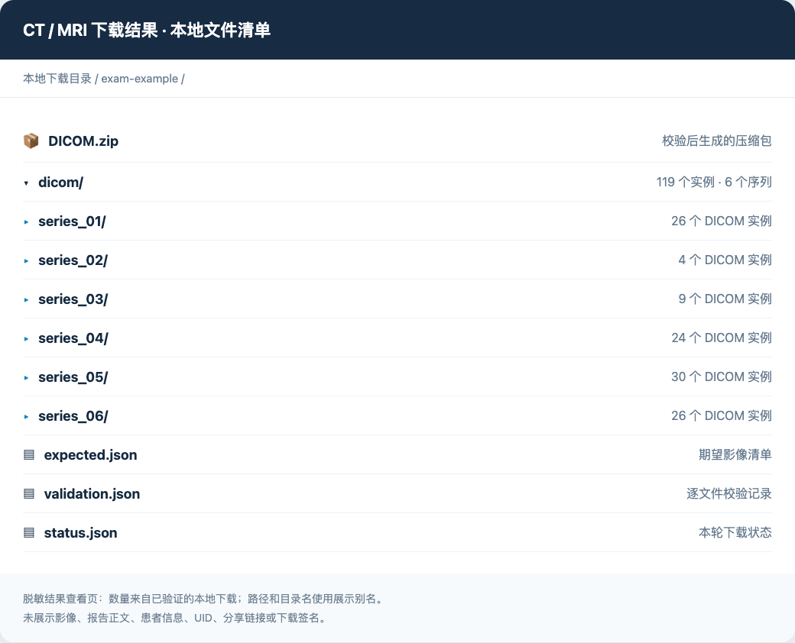
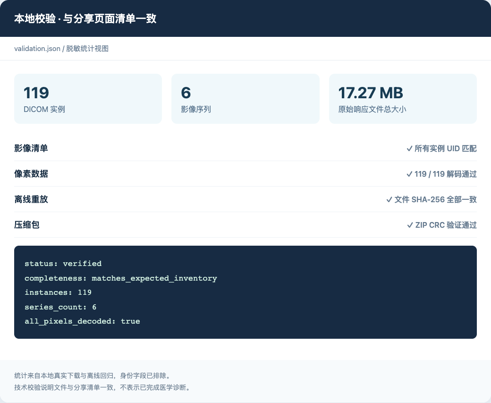

<!-- Modified from Kaciras/cloud-dicom-downloader: agent-facing Skill, Radinfo adapter and validation workflow. -->
# CT / MRI 云影像下载 Skill

把医院分享链接交给大模型，下载这一次检查中的 DICOM 文件，核对下载结果，并按需读取和解释检查报告。

本项目基于 [Kaciras/cloud-dicom-downloader](https://github.com/Kaciras/cloud-dicom-downloader) 改写，新增面向模型的 [SKILL.md](SKILL.md)、微影 / Radinfo 适配器，以及统一的下载校验入口。医院网站不同，支持能力与验证范围也不同；详情见 [平台支持表](references/platforms.md)。

[安装](#安装到-codex) · [告诉模型什么](#告诉模型什么) · [执行后的结果](#执行后的结果) · [命令行使用](#命令行使用) · [平台支持](#平台支持与限制) · [来源与许可证](#来源与许可证)

## 告诉模型什么

安装后，在新对话中发送完整分享链接即可。可以明确要求只下载，或同时保存、解释报告：

> 使用 $cloud-dicom-downloader 下载这个 MRI 分享链接中的全部可用影像，保存到本地并核对完整性：〈完整分享链接〉

> 使用 $cloud-dicom-downloader 下载这份 CT 的 DICOM，同时保存报告原文，并解释报告结论：〈完整分享链接〉

> 校验这个本地检查目录里的 DICOM：〈本地目录的绝对路径〉。

保留分享链接中的完整查询参数和 `#` 后内容。若网站需要报告密码、登录或验证码，提供有效访问入口；不要把真实链接或密码写入 Git 仓库。模型会将运行请求保存在仓库之外的私有文件中。

## 执行后的结果

完成下载后，你会得到可导入 DICOM 阅片软件的影像目录、ZIP 压缩包和校验记录。MRI / CT 通常由多个序列和切面组成，DICOM 是主要保存格式；MP4 或 PNG 只是派生预览。

下图是**本地下载结果的脱敏查看页截图**。实例数量和校验统计来自已完成的本地下载与离线回归；路径、目录名使用展示别名。截图没有展示医疗影像、报告正文、患者信息、UID 或分享链接。



这一案例下载了 **6 个序列、119 个 DICOM 实例**，逐张像素解码通过。新适配器对本地真实资料做离线重放时，119 个文件的 SHA-256 与原备份一致。



典型输出：

```text
exam-001/
├── DICOM.zip
├── dicom/
│   ├── series_<hash>/
│   │   ├── <hash>.dcm
│   │   └── ...
│   └── ...
├── expected.json       # 远端期望清单（微影适配器）
├── validation.json     # 数量、UID、解码结果、SHA-256
├── status.json         # 本轮执行状态
└── report.json         # 可选；用户要求保存报告时生成
```

`verified` 表示本地 DICOM 验证通过；只有 `matches_expected_inventory` 才表示与该分享页的清单一致。继承适配器尚未统一远端清单时，会明确返回 `unknown_no_remote_inventory`。技术校验不代表医学诊断，也不能证明医院没有另外保存或未分享的序列。

## 安装到 Codex

需要 Git、Python **3.11 或更高版本**。以下为 macOS / Linux 安装方法：

```bash
mkdir -p "$HOME/.codex/skills"
git clone https://github.com/Cirsever/cloud-dicom-downloader-skill.git \
  "$HOME/.codex/skills/cloud-dicom-downloader"
```

在新对话中使用 `$cloud-dicom-downloader`。如果当前会话尚未显示该 Skill，开启新会话让宿主重新发现技能。

运行依赖安装在 Skill 目录之外，避免把虚拟环境和医疗文件混入仓库：

```bash
python3 -m venv "$HOME/.local/share/cloud-dicom-downloader/venv"
"$HOME/.local/share/cloud-dicom-downloader/venv/bin/python" -m pip install \
  -r "$HOME/.codex/skills/cloud-dicom-downloader/requirements-skill.txt"
```

多数 HTTP 适配器不需要启动浏览器。飞图等浏览器适配器还需要 Chromium：

```bash
"$HOME/.local/share/cloud-dicom-downloader/venv/bin/python" -m playwright install chromium
```

也可通过 `DICOM_BROWSER_EXECUTABLE` 指定已安装的 Chromium 系浏览器。压缩 DICOM 的像素验证需要解码器，`requirements-skill.txt` 已包含 JPEG Lossless、JPEG 2000 与 RLE 所需依赖。

已安装用户更新：

```bash
git -C "$HOME/.codex/skills/cloud-dicom-downloader" pull --ff-only
```

其他支持目录型 Skill 的宿主，可加载整个项目目录中的 `SKILL.md`；宿主技能目录各不相同，Python 执行入口保持一致。

## 命令行使用

也可以不经过模型，直接调用脚本。先在私有工作目录创建 `request.json`，将示例值替换为自己的完整链接和输出绝对路径：

```json
{
  "url": "替换为完整医院分享链接",
  "output_dir": "/absolute/private/downloads/exam-001",
  "platform": "auto",
  "include_report": false,
  "zip": true
}
```

执行时不要把 URL 或密码作为命令行参数：

```bash
chmod 600 /private/work/request.json
python /path/to/cloud-dicom-downloader/scripts/dicom_skill.py \
  plan --request /private/work/request.json
python /path/to/cloud-dicom-downloader/scripts/dicom_skill.py \
  download --request /private/work/request.json
```

`plan` 只检查本地路由，不访问医院，也不证明链接有效。`download` 成功后返回 JSON 状态；失败返回非零退出码，并保留可解释的部分下载状态。

已有文件可以离线验证：

```bash
python /path/to/cloud-dicom-downloader/scripts/dicom_skill.py \
  inspect /private/downloads/exam-001 \
  --expected /private/downloads/exam-001/expected.json \
  --output /private/work/validation.json
```

全部选项、超时、续传及输出字段见 [输入输出契约](references/input-output.md)。旧 `downloader.py` 仅作为上游位置参数接口的兼容入口；模型使用新的私有请求入口。

## 平台支持与限制

| 平台 | 当前范围 |
| --- | --- |
| 微影 / Radinfo：`yyx.zy91.com` | 新增适配器；真实本地 119 实例验证、离线重放与合成端到端测试通过 |
| 海纳医信、重庆卫健委、申康、中山医院、飞图、聚典云、明天医网、医众、篮网云、jdyfy | 保留上游适配实现；本轮没有逐站完成线上回归 |
| 其他医院部署 | 先识别平台及导出能力；不会仅根据相似域名猜测接口 |

上游某些平台会使用标签和像素重建 DICOM，应与“医院接口直接返回的原文件”区分。微影保存原响应字节、不重新编码。只提供截图或受登录权限限制的网站可能无法导出 DICOM。

见 [平台表](references/platforms.md)、[微影技术案例](references/radinfo-case.md)、[报告分析方式](references/report-analysis.md)、[完整项目 Review](references/review.md)。下载工具不内置医学诊断模型；报告解释以取得的原报告为依据。

## 开发与验证

```bash
python -m pip install -r requirements-test.txt
python -m pytest
```

当前 **33 项离线测试通过**，覆盖输入检查、清单解析、UID 错配、缺图、续传、灰度 / RGB / 多帧像素、HTTP 重试、地址检查和兼容工具。测试使用合成数据；真实医疗资料不作为 fixture。

验证范围见 [validation-summary.json](references/validation-summary.json)。分发文件的 SHA-256 记录在 [release-manifest.json](release-manifest.json)；它校验文件版本，不替代运行测试。截图只是脱敏结果展示页，项目不包含完整图形阅片界面。

## 来源与许可证

- 上游：[Kaciras/cloud-dicom-downloader](https://github.com/Kaciras/cloud-dicom-downloader)
- 上游基线：`f77568cbda18788df92a9d9b92c9de99c07753c7`
- 来源、归属及改写说明：[ATTRIBUTION.md](ATTRIBUTION.md)
- 完整许可证：[LICENSE](LICENSE)，**Apache License 2.0 附带 Commons Clause 条件**，不是纯 Apache-2.0。

公开仓库从已检查的文件建立独立 Git 历史。上游原始网络样本历史、真实 DICOM、报告原文、患者信息和签名分享链接未进入发布历史。脱敏案例仅保留技术流程与计数；仓库中的请求示例和测试参数均为占位符或合成数据。
